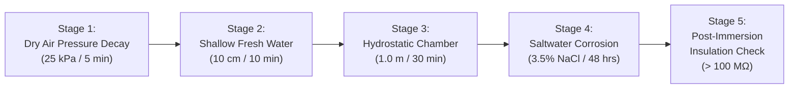

# TIDES Safety Band — Prototype Enclosure, Electrical Safety & Immersion Manual
**Track B — Phase 3: Physical Safety Band Prototype (Model: TSB-HW-01)**

---

## 1. Mechanical Enclosure & Gasket Sealing Specifications

```
  +--------------------------------------------------------------+
  |              TOP SHELL (CNC Polycarbonate / POM)             |
  |  +--------------------------------------------------------+  |
  |  |           IP68 Sealed Silicone Pushbutton Boot         |  |
  |  +--------------------------------------------------------+  |
  |  |           Diffuse Acrylic Diffuser for Status LEDs     |  |
  |  +--------------------------------------------------------+  |
  |                                                              |
  |  ==========================================================  | <-- Custom Silicone O-Ring (Shore 50A)
  |  [ Groove: 1.6mm W x 1.1mm H | Gasket Cross-Section: 1.4mm ] |     Nominal Compression: 25% - 28%
  |  ==========================================================  |
  |                                                              |
  |             INTERNAL CHASSIS & CONFORMAL COATED PCB          |
  |             [ 500mAh Li-Po Cell with Kapton Tape ]           |
  |             [ 1027 Encapsulated Coin Vibration Motor ]       |
  |                                                              |
  |  ----------------------------------------------------------  |
  |           BOTTOM SHELL (Flush Contoured Wrist Surface)       |
  |  [ 4x Gold-Plated Magnetic Pogo-Pin Hermetic Charge Dock ]   |
  |  [ 4x Marine Grade A4-316 Stainless Steel Machine Screws ]   |
  +--------------------------------------------------------------+
```

### 1.1 Gasket Geometry & Compression Calculation
- **Gasket Material**: Medical-grade molded fluorosilicone / silicone elastomer (durometer: 50 Shore A).
- **Nominal Cross-Section Diameter**: $d = 1.40\text{ mm} \pm 0.05\text{ mm}$.
- **Gland/Groove Dimensions**:
  - Width: $w = 1.65\text{ mm}$ (provides $118\%$ volumetric gland fill, preventing gasket pinch).
  - Depth: $h = 1.05\text{ mm}$.
- **Compression Ratio**:
  $$\text{Compression} = \frac{d - h}{d} = \frac{1.40\text{ mm} - 1.05\text{ mm}}{1.40\text{ mm}} = 25.0\%$$
  *(Target range $22\%\text{--}30\%$ for static water submersion up to $1.5\text{ m}$ hydrostatic head).*
- **Fasteners**: 4x M2.5 $\times$ 8mm DIN 912 Socket Head Screws made of **Marine Grade A4-316 Stainless Steel** (resistant to coastal pitting corrosion from saline chloride ions). Tightened to a torque of $0.28\text{ Nm}$ in a cross-diagonal sequence.

---

## 2. Electrical Protection & Charging Safety

### 2.1 Battery Protection Circuit (DW01A + FS8205A)
- **Overcharge Protection Voltage**: $4.30\text{ V} \pm 0.05\text{ V}$ (disconnects charger FET within $100\text{ ms}$).
- **Overdischarge Cutoff Voltage**: $2.40\text{ V} \pm 0.10\text{ V}$ (prevents copper dendrite growth and cell degradation).
- **Overcurrent / Short Circuit Cutoff**: $3.2\text{ A}$ (instantaneous shutdown within $10\text{ µs}$).
- **Thermal Cutoff**: An onboard 10kΩ NTC thermistor is thermally bonded to the Li-Po pouch; charging terminates if cell temperature exceeds $+45^\circ\text{C}$ or drops below $0^\circ\text{C}$.

### 2.2 Magnetic Charging Port Sealing
- The charging interface consists of 4 gold-plated ($20\text{ µm}$ hard gold over nickel) magnetic pogo pins embedded in an epoxy-sealed ceramic base.
- **Circuit Protection**:
  - A Schottky blocking diode (BAT54CW) prevents reverse discharge if saltwater bridges the exterior pins.
  - A USBLC6-2SC6 low-capacitance TVS diode array protects the UART data lines and power rail against human-body electrostatic discharge (up to $\pm 15\text{ kV}$ air discharge).

> [!CAUTION]
> **Safety Rule 1**: **NEVER** connect the magnetic charging cable while the wristband is damp or wet. The device must be rinsed in fresh water, thoroughly dried with a microfiber towel, and air-dried for at least 15 minutes prior to dock connection.

---

## 3. Controlled 5-Stage Immersion-Resistance Test Protocol

To guarantee real-world water resistance without risking swimmer safety, every prototype unit must pass the following laboratory bench validation sequence:



1. **Stage 1 — Dry Pneumatic Pressure Decay Leak Test**:
   - The sealed enclosure (without electronics, containing a pressure sensor) is placed in a vacuum test chamber at $25\text{ kPa}$ relative differential pressure for 5 minutes.
   - **Pass Criterion**: Pressure decay rate $< 0.02\text{ kPa/min}$.
2. **Stage 2 — Shallow Fresh Water Dip**:
   - Assembled prototype submerged to $10\text{ cm}$ depth in deionized water for 10 minutes.
   - **Pass Criterion**: No air bubbles expelled; full functional test of button and LEDs immediately post-removal.
3. **Stage 3 — Hydrostatic Water Column Submersion (IP68 Target)**:
   - Submerged in a pressurized hydrostatic test tank to an equivalent water depth of $1.0\text{ meter}$ ($10\text{ kPa}$ gauge pressure) for $30\text{ minutes}$ at $25^\circ\text{C}$.
   - **Pass Criterion**: Zero moisture ingress; internal relative humidity sensor reading $< 65\%$.
4. **Stage 4 — Accelerated Saltwater Corrosion Soak**:
   - Submerged in synthetic seawater ($3.5\%\text{ NaCl}$ concentration at $30^\circ\text{C}$) for $48\text{ hours}$.
   - **Pass Criterion**: Zero galvanic pitting on 316 stainless screws; pogo pins maintain contact resistance $< 80\text{ m}\Omega$.
5. **Stage 5 — Post-Immersion Insulation & Megger Test**:
   - High-voltage insulation resistance measured between exterior metal pins and internal battery rails at $100\text{ V DC}$.
   - **Pass Criterion**: Insulation resistance $> 100\text{ M}\Omega$.

